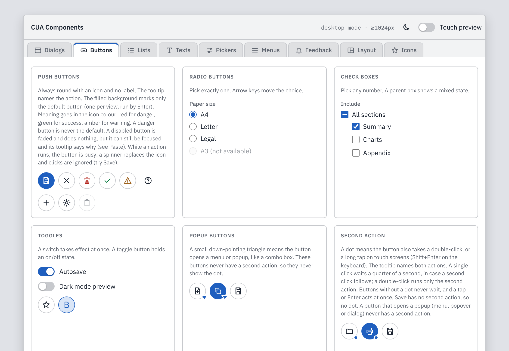
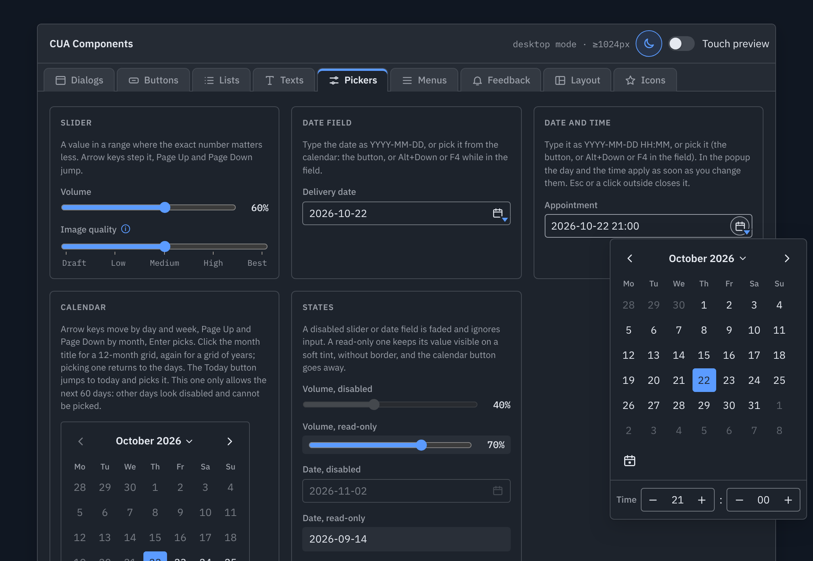

<div align="center">

# Ayni : Modern web CUA

**One way of working, on every screen.**

A consistent, modern and intuitive user-interface library where every control follows the same rules.
Plain HTML, CSS and JavaScript. No framework, no build step, nothing to install.

[**Open the gallery**](https://peyrona.github.io/ayni/gallery/) · [Read the design guidelines](docs/guidelines.md) · [Quick start](#quick-start)

</div>



## Why Ayni

Most interfaces grow one screen at a time, and every screen invents its own little habits. Ayni starts from the other end: first the rules, then the controls that obey them. The result is an interface that feels the same everywhere.

- **Consistent.** One look per state across every control. Disabled is always faded, read-only is always a soft tint, an error is always a red border with a small "!".
- **Congruent.** Each sign means one thing. A filled button is the default, and nothing else. A small dot means "this button has a second action". A small triangle means "this opens something".
- **Intuitive.** Things work the way people already expect: Esc closes, Enter runs the default button, typing jumps to a match in any list, and a long tap means "more for this thing".

## What makes it different

**Round, icon-only buttons.** Every button is a circle with an icon and a tooltip. Colour carries meaning (red for danger, green for success, amber for warning), and a danger button is never the default.

**A second action, clearly marked.** A small dot on a button says it also takes a double-click, a long tap on touch screens, or Shift+Enter. The tooltip names both actions, and a ring fills in while you hold.

**Five colours make a theme.** Each scheme, light and dark, is defined by five base colours: paper, ink, accent, alert and danger. Every other colour is worked out from them in the browser, so a new brand is five values away. Light and dark follow the system until the user picks one.

**Touch-first, not touch-afterwards.** On a touch screen every target grows to at least 44 × 44 px. Tooltips give way to a Help button that lists everything on the screen and explains it. Drop-down lists become bottom sheets that stay above the on-screen keyboard.

**Dialogs without the Cancel/OK dance.** Changes apply as they are made, or when the dialog closes. Esc always closes a dialog, and an extra button appears only when it is really needed.

**Errors that don't push the layout around.** Nothing is added below a field. The border turns red, a small "!" appears inside the field, and the message pops up while you are in the field.

**Nothing to build.** Three files, `cua.css`, `cua.js` and `cua-icons.js`, work straight from disk or from any static web server. The target is evergreen browsers from 2024 on.



## What's inside

| Family | Controls |
| --- | --- |
| **Buttons** | Push buttons, default and busy buttons, toggles, popup buttons, second-action buttons, radio buttons, check boxes with a mixed state, switches |
| **Lists** | Single and multiple selection lists with type-ahead, drop-down list, combo box, all with one list picker on every device |
| **Texts** | Text fields with buttons inside, search field with filter, password show/hide, text area with a counter, number field, progress, info labels |
| **Pickers** | Slider, date field, date and time, a calendar with month and year views and date limits |
| **Menus** | Menu bar, pull-down menus, pop-up menus (right-click, long tap, Shift+F10), toolbar, popups that hold any control |
| **Feedback** | Tooltips, notifications with Undo (and Ctrl+Z that keeps working afterwards), status bar, loading and empty states |
| **Layout** | Panels, tabs (closable, scrollable, keyboard-friendly), group boxes, a splitter with collapse and reset, scrolling everywhere |
| **Dialogs** | Message, live settings, apply on close, confirmation, modeless |

Everything works from the keyboard, with a mouse and by touch, and every state is shown in the gallery.

## Quick start

Copy `cua.css`, `cua.js` and `cua-icons.js` next to your page:

```html
<link rel="stylesheet" href="cua.css">
<script src="cua-icons.js" defer></script>
<script src="cua.js" defer></script>

<button class="btn primary" aria-label="Save" data-tip="Save">
  <svg class="icon"><use href="#i-save"/></svg>
</button>
```

That's it: the library finds its controls when the page loads. Then open [`gallery/index.html`](gallery/index.html), find the control you need and copy its markup.

## The gallery

The gallery is the living reference. It shows every control in every state, in light and dark, with a **Touch preview** switch so you can try the touch layout with a mouse. Open it [online](https://peyrona.github.io/ayni/gallery/) (once GitHub Pages is turned on for this repository), or open `gallery/index.html` straight from your disk.

The rules behind every control are in the [Ayni Design Guidelines](docs/guidelines.md) book. The book says what the rules are, and the gallery shows them working.

## Roadmap

Ayni is at version 0.1.0. The design is still being closed, so the markup and the API may change before 1.0.

- [ ] **The final icon set.** The current icons are examples.
- [ ] **Desktop mode.** From 1024 px wide, Ayni will switch on its own to a desktop with windows that float, move and resize, plus a taskbar.
- [ ] **Tree view.** It works in the gallery, but its design will be reviewed.
- [ ] **Accessibility for everyone.** Screen readers, captions, right-to-left languages and Windows High Contrast come once the design is closed.

---

# Reference

## Using the library

```html
<!doctype html>
<html lang="en">
<head>
  <meta charset="utf-8">
  <meta name="viewport" content="width=device-width, initial-scale=1, viewport-fit=cover">
  <link rel="stylesheet" href="https://fonts.googleapis.com/css2?family=IBM+Plex+Sans:wght@400;500;600&family=IBM+Plex+Mono:wght@400;500&display=swap">
  <link rel="stylesheet" href="cua.css">
  <script src="cua-icons.js" defer></script>
  <script src="cua.js" defer></script>
  <script src="app.js" defer></script>
</head>
<body>
  <section class="panel">
    <header><h2>Invoices</h2></header>
    <div class="body">
      <button class="btn primary" aria-label="Save" data-tip="Save"><svg class="icon"><use href="#i-save"/></svg></button>
    </div>
  </section>
</body>
</html>
```

Load the scripts with `defer`, in this order. When the page has loaded, `cua.js` wires up every control it finds. For content added later, call `CUA.init(element)`; a control is never wired twice, so calling it again is safe.

The markup of each control is the one in `gallery/index.html`: copy a specimen from there and change its text. The main building blocks are:

| Control | Markup |
| --- | --- |
| Panel (the base surface of windows, dialogs, menus and popups) | `.panel` with `header`, `.body` and `footer` |
| Button (round, icon only, always with a tooltip) | `button.btn` with `aria-label` and `data-tip`; `.primary` marks the default button; `.danger`, `.ok`, `.warn` colour the icon; `.quiet` has no border |
| Toggle button | `.btn` with `aria-pressed` and `data-toggle` |
| Second action (double-click, long tap, Shift+Enter) | `data-alt="what it does"` on a `.btn`; listen for `cua:press` |
| Busy button | `CUA.setBusy(button, 'Saving…')`, then `CUA.setBusy(button, false)` |
| Disabled button | `aria-disabled="true"` (stays focusable, its tooltip says why) |
| Tooltip | `data-tip` on any element |
| Info label | `button.info-tip` with `popovertarget="cua-help"` and `data-help` |
| Tabs | `[role="tablist"]` with `[role="tab"]` and `[role="tabpanel"]`; `data-closable` and a `[data-close]` span for closable tabs; `data-hash` keeps the tab in the address |
| List box | `ul.lb[role="listbox"]`, `aria-multiselectable="true"` for several |
| Drop-down list and combo box | `.picker` with `data-picker="list"` or `data-picker="combo"` |
| Text field with buttons inside | `.input-group` |
| Search field | `.input-group.search-field` with a `[data-clear]` button |
| Password with show/hide | a `.btn` with `data-reveal` inside the `.input-group` |
| Text area with a count | `.ta-wrap` with `textarea[maxlength]` and `.ta-count` |
| Number field | `.input-group.spin` with `data-min`, `data-max`, `data-step` on the input |
| Field error | `aria-invalid="true"` plus `aria-describedby` pointing at a `.error` element with the message |
| Menu, pop-up menu | `.panel.menu[popover][role="menu"]` with `[role="menuitem"]` buttons; menu bar is `[role="menubar"]` |
| Popup with controls | `.panel.popup.controls[popover]` |
| Dialog | `dialog.panel`; any element with `data-open-dialog="id"` opens it |
| Splitter | `.split` (`.split.rows` for top and bottom) with two `.pane` and a `.splitter` between them |
| Light/dark toggle | `data-theme-toggle` on a button |
| Status bar | `.statusbar`; mark the message cell with `data-cua-status` |

A few controls need one call because they take options:

```js
CUA.toolbar(document.querySelector('#my-toolbar'));                 // one Tab stop, arrows move
CUA.calendar(element, (date) => { … });                             // inline calendar
CUA.dateField(input, { popup, onChange: (date) => { … } });         // YYYY-MM-DD field with a calendar popup
CUA.dateTimeField(input, { popup, value, onChange: (date) => { … } }); // YYYY-MM-DD HH:MM
CUA.contextMenu(area, { menu, target: (event) => ({ name, back }) });  // right-click, long tap, Shift+F10
```

### Events

Controls tell the page what happened with DOM events that bubble, so one listener on `document` can serve the whole page.

| Event | Fired on | `event.detail` |
| --- | --- | --- |
| `cua:change` | `.lb` list box | `{ selected }`: the texts of the selected items |
| `cua:change` | `.picker` | `{ value, name, field, input }` |
| `cua:press` | `.btn[data-alt]` | `{ second, label }`; use it instead of `click` on these buttons |
| `cua:action` | `.panel.menu` | `{ item, menu, act }`: the chosen item, the menu's name, its `data-act` |
| `cua:choose` | `.panel.menu` | the chosen `menuitemradio` |
| `cua:tabselect`, `cua:tabclose` | `[role="tablist"]` | the tab |
| `cua:select` | `[role="tree"]` | `{ item, path }` |
| `cua:split` | `.split` | `{ action, pane, message }` |
| `cua:theme` | the toggle button | `{ theme }` |
| `cua:dismiss` | an open menu or popup, before the page scroll or a resize closes it | cancel it with `preventDefault()` to keep the popup |

### JavaScript API

Everything lives on `window.CUA`: `init`, `status(text)`, `toast(kind, text, { action, persist })`, `setBusy`, `place(popup)`, `contextMenu`, `toolbar`, `calendar`, `dateField`, `dateTimeField`, `fillHelp(body, entries)` (the touch Help dialog), `focusFirstError(root)`, `isTouch()`, `setTouchPreview(on)`, `isDark()`, `setTheme('light' | 'dark' | null)`, the date helpers in `CUA.dates`, and `version`.

### Colours

Each scheme, light and dark, is defined by five base colours at the top of `cua.css`: `--c-paper` (backgrounds), `--c-ink` (text), `--c-accent` (selection, default button), `--c-alert` (focus ring, warnings) and `--c-danger` (errors, destructive actions). Every other colour is derived from them, so a new scheme is five new values. The page follows the system setting until the user picks light or dark; the choice is kept in `localStorage` under `cua-theme`.

## Files

| File | What it is |
| --- | --- |
| `cua.css` | The look of every control, both colour schemes and the touch sizes |
| `cua.js` | The behaviour of every control |
| `cua-icons.js` | The icon sprite (24×24 grid, 2px stroke) |
| `gallery/` | The gallery page, with its own layout and demo wiring (not needed by apps) |
| `docs/guidelines.md` | The Ayni Design Guidelines: every rule, chapter by chapter |
| `docs/accessibility-backlog.md` | Accessibility work planned for after the design is closed |
| `docs/*.png` | Images for this page |
| `CHANGELOG.md` | What changed in each version |

## Licence

Apache 2.0.
