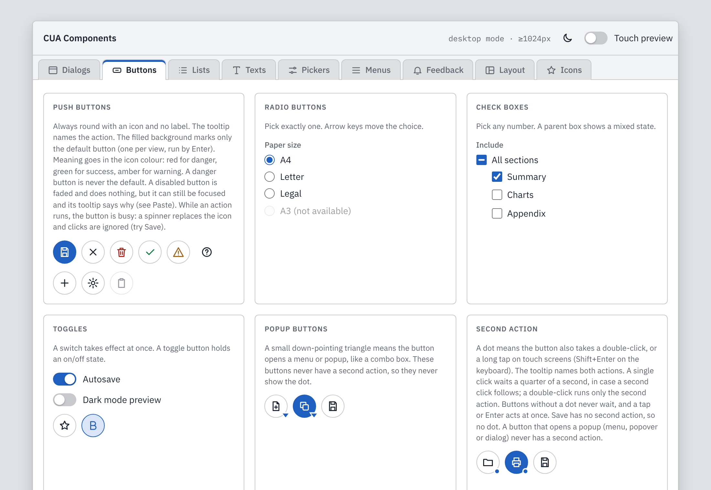
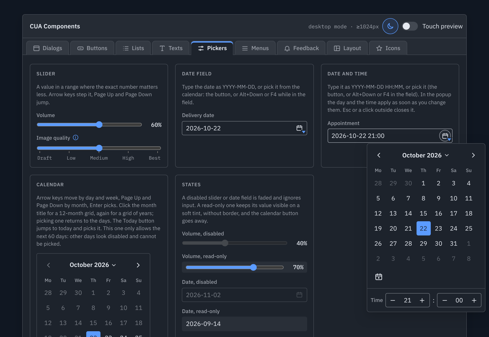

<div align="center">

# Ayni

**One way of working, on every screen.**

A web user-interface library where every control follows the same rules.<br>
Plain HTML, CSS and JavaScript: no framework, no build step, nothing to install.

[**Try the gallery**](https://peyrona.github.io/ayni/gallery/) · [Download](https://github.com/peyrona/ayni/releases/latest) · [Guidelines](docs/guidelines.md) · [Reference](docs/reference.md)

</div>



## Why Ayni

- **Same rules everywhere.** Disabled is always faded, an error is always a red edge with a "!", a dot always means "this button does a second thing".
- **Works the way people expect.** Esc closes, Enter runs the default, typing jumps to a match, a long tap means "more".
- **Touch first.** On touch screens every target is at least 44 px, lists become bottom sheets, help is one (?) away.
- **Light, dark or the sun.** Follows the system, the user's pick or the real sunrise and sunset. Users can make their own colour schemes.
- **Five languages, zero network.** English, Spanish, Portuguese, French and German built in; system font; nothing loaded from other sites.
- **Take only what you use.** One small file pair per family of controls, served by any static web server.



## What's inside

**Buttons** · **Lists and trees** · **Text fields and search** · **Date, time and list pickers** · **Menus and toolbars** · **Dialogs** · **Notifications with Undo** · **Help card and guided tour** · **Tabs, panels and splitters** · **A full desktop with windows and a taskbar**

Plus optional parts for whole apps: offline data, documents with autosave, a screen locker, media, maps, photos, sharing and uploads. The [`sample/`](sample/) app is made of Ayni alone.

Everything works with a keyboard, a mouse and a finger. Browsers from 2024 on (Chrome 119, Firefox 128, Safari 18).

## Quick start

1. [Download the latest release](https://github.com/peyrona/ayni/releases/latest) and copy the files next to your page.
2. Load the base and the families you need:

```html
<script src="ayni-i18n.js"></script>
<script src="ayni-util.js"></script>
<link rel="stylesheet" href="ayni-base.css">
<link rel="stylesheet" href="ayni-buttons.css">
<link rel="stylesheet" href="ayni.css">
<script src="ayni-icons.js" defer></script>
<script src="ayni-base.js" defer></script>
<script src="ayni-buttons.js" defer></script>

<button class="btn primary" data-i18n-attr="aria-label:new, data-tip:new">
  <span class="icon" data-icon="plus"></span>
</button>
```

3. Open the [gallery](https://peyrona.github.io/ayni/gallery/), find the control you need and copy its markup.

The full list of files, events and the JavaScript API is in the [reference](docs/reference.md); the rules behind every control are in the [design guidelines](docs/guidelines.md).

## Built with Ayni

[**Nayive**](https://github.com/peyrona/nayive): personal web apps you host yourself (Drive, Office, Chat, Photos and more).

## Licence

[Apache 2.0](LICENSE) · [What changed](CHANGELOG.md)
